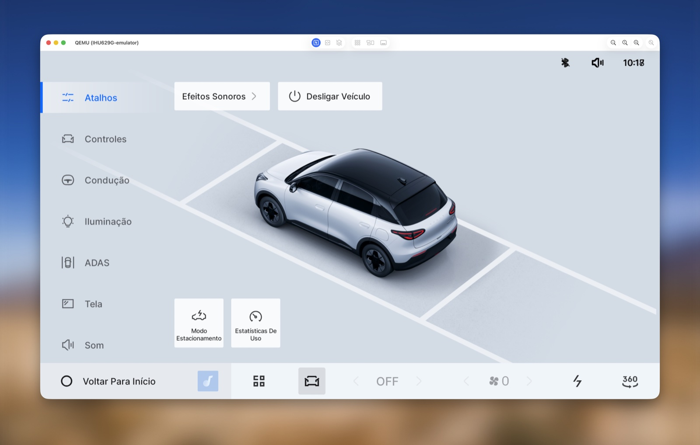

# IHU629G-emulator

**English** | [Português (Brasil)](README.pt-BR.md)

Emulator of the multimedia head unit of the **Geely EX2 sold in Brazil**:
**ECARX E02 / IHU629G** running **Android 9 and Flyme Auto**, on an
Apple Silicon Mac under QEMU with HVF acceleration. It uses a real dump
from the car, an adapted Linux 4.14 kernel, and targeted replacements to
run the firmware outside the original hardware.



Interactive UI, touch and adb available in about **one minute** (68 s in
the 2026-10-19 check).

## What works

- Flyme Auto UI at 1920×1080, with mouse/touch and keyboard.
- Screen via VNC (`127.0.0.1:5901`, password `ex2emu`) or a native QEMU window.
- adb root, crash diagnostics, and 32-bit ARM services via qemu-arm.
- Simulated vehicle properties: gear, speed, battery, day/night.
- Parked-car state and automatic clock adjustment.

## Requirements

- **Apple Silicon** Mac (HVF; there is no x86 path here) with a current macOS.
- Homebrew: `qemu` (11.1 tested), `tmux`, `coreutils`; plus `adb` and `python3`.
- **Docker** - all Linux tooling (debugfs, dtc,
  gcc-9, kernel build) runs in an Ubuntu 20.04 arm64 container; QEMU
  itself runs on the host, never in the container.
- ~60 GB free + space for the dump.

## Firmware

**Firmware and the dump are not distributed.** You must provide a valid
dump from your own Brazilian Geely EX2 unit. The original images are
read-only; all changes and guest writes go to `work/qemu/ex2.img`.

## Required dump and layout

The unit dump (full eMMC read) lives in `dump/` at the project root
(gitignored) or in the directory given by `EX2_DUMP`: **one raw file per
partition** (dd-style; not Android sparse/simg, not compressed), named
`<partition>.img`. The disk stage (`tools/qemu/14_gpt.sh`) copies these
46 partitions:

```
proinfo nvram protect1 protect2 lk lk2 boot boot_para para recovery logo
expdb seccfg otp tee1 tee2 scp1 scp2 sspm_1 sspm_2 spmfw gz1 gz2 dtbo frp
nvcfg nvdata metadata persist pki private_ui vechilecfg system vendor
cache userdata mtkdata log md1img md1dsp md1arm7 md3img cam_vpu1 cam_vpu2
cam_vpu3 odmdtbo
```

Missing partitions are skipped with a warning; **boot, system, vendor and
userdata are essential**. Also copy `boot.img`, `system.img` and
`vendor.img` to `firmware/` (stages 0/1/5 read from there):

```sh
export EX2_DUMP="$PWD/dump"     # or an absolute path to your dump directory
mkdir -p firmware
cp -c "$EX2_DUMP"/{boot,system,vendor}.img firmware/   # cp -c: instant APFS clone
```

A first build also needs Android 9/API 28 GSI images, a gralloc blob
extracted from your dump, and a redroid blob pulled from Docker Hub -
see [First build](#first-build) below.
`run.sh` starts the prepared emulator; it does not build the images, and
the full pipeline was not re-run on a clean clone in this revision.

## Quick start

```sh
./run.sh                       # boot + VNC + adb + baseline VHAL
./run.sh --cocoa               # native QEMU window instead of VNC
./run.sh --status              # guest state
./run.sh --stop                # graceful stop (guest sync first)

adb -s 127.0.0.1:5555 shell    # root shell
python3 tools/qemu/vhalctl.py setf 0x11600207 50   # 50 km/h
python3 tools/qemu/vhalctl.py set 0x2140800f 4     # gear D (1=P 2=R 3=N)
```

One guest at a time - `run.sh` refuses to start while another guest is
already running. To switch the display of the running guest (e.g. from
VNC to the native QEMU window), stop it first:
`./run.sh --stop && ./run.sh --cocoa`.

## First build

<details>
<summary>Inputs you must provide, and the full stage order</summary>

Everything runs from the project root. The dump layout and the
`firmware/` copies are described above; a first build additionally
needs:

- **Android 9/API 28 arm64 GSI images** (raw ext4) at
  `work/android-sdk/system-28-raw.img` and
  `work/android-sdk/vendor-28-raw.img` - e.g. from the SDK package
  `system-images;android-28;default;arm64-v8a`; if the source is an
  Android sparse image, convert it with `simg2img` first.
- **`work/fw-gfx/gralloc.default.so`** - extracted from your own dump
  (no stage does this):

  ```sh
  tools/drun.sh -- bash -c \
    'mkdir -p /project/work/fw-gfx && debugfs -R \
     "dump /lib64/hw/gralloc.default.so /project/work/fw-gfx/gralloc.default.so" \
     /project/firmware/vendor.img'
  ```

- **Docker with network access** - `tools/02_blobs.sh` pulls
  `redroid/redroid:9.0.0-latest` from Docker Hub (SwiftShader, BT stub).

Stage order (order matters; every stage is idempotent):

```sh
./tools/00_verify.sh && ./tools/01_meta.sh && ./tools/05_boot.sh
./tools/02_blobs.sh                 # redroid + GSI extraction, byte patches
./tools/qemu/10_kernel.sh           # ~8 min, native build in the container
./tools/qemu/12_dtb.sh              # DTB must match machine.sh (EX2_MEM!)
./tools/qemu/40_build_qemu_arm.sh   # qemu-arm with binder; BEFORE stage 13
./tools/qemu/13_ramdisk.sh
./tools/qemu/14_gpt.sh --force      # ~2 min, needs the dump
./tools/qemu/15_inject_swiftshader.sh
./tools/qemu/16_audio.sh
./tools/qemu/17_bluetooth.sh
./tools/qemu/18_adbd.sh
./tools/qemu/19_display.sh
./tools/qemu/21_aee_stub.sh         # stock crash dumps (tombstones)
./tools/qemu/22_usb_public_volume.sh
./tools/qemu/23_disable_omx.sh      # stops the OMX tombstone loop
./run.sh
```

</details>

## Security

Research environment: **adb root without authentication, SELinux
permissive, and the original unit's data in userdata**. VNC, adb and
VHAL are bound to `127.0.0.1` only. Do not expose the ports and do not
publish your dump or working disk.

## Limitations

- No real audio output, cameras/360° view, or instrument-cluster display.
- MCU/CAN and vehicle hardware are not reproduced; VHAL gets simulated values.
- Media/OMX codecs and MTK ION dependencies do not work fully.
- DRM/Widevine unavailable; known visual artifacts in the status bar.
- Validated on Apple Silicon macOS only; no x86 support.

Details: [known issues](BLOCKERS.md).
